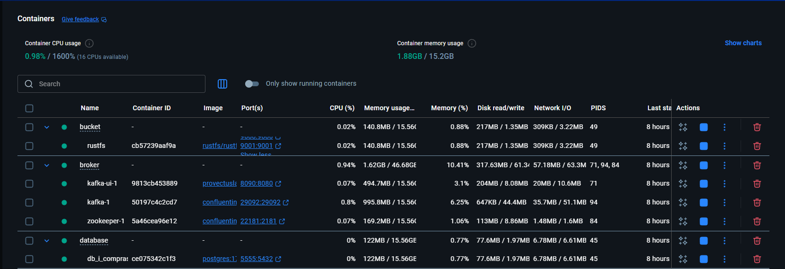
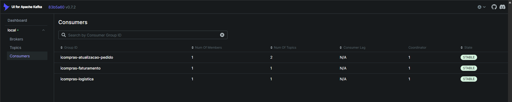
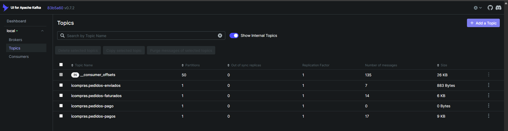
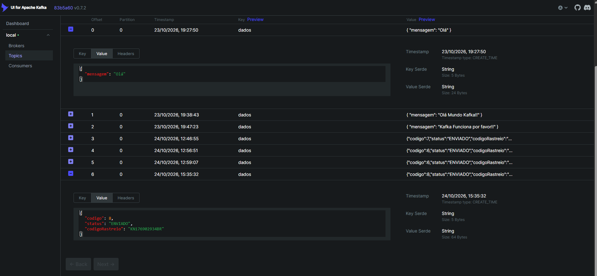
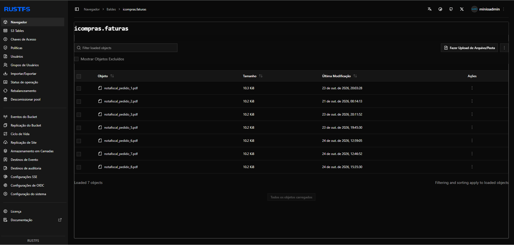

# 🚀 iCompras - Microsserviços de E-commerce com Kafka

Bem-vindo ao projeto `iCompras`, uma solução de e-commerce baseada em microsserviços em Java com Spring Boot, comunicação assíncrona via Kafka e persistência em PostgreSQL. O sistema simula um fluxo completo de pedidos, incluindo cadastro de clientes e produtos, processamento de pagamentos, geração de nota fiscal e envio do pedido.

## ✨ Descrição detalhada da aplicação

O iCompras é uma arquitetura de microsserviços projetada para separar responsabilidades de negócio em módulos independentes, permitindo escalabilidade, autonomia e manutenção mais simples. Cada serviço representa uma parte do fluxo de compra e se comunica por APIs REST e eventos Kafka.

O fluxo principal funciona assim:

1. `clientes` registra dados do cliente.
2. `produtos` mantém o catálogo e informações dos itens.
3. `pedidos` cria o pedido, valida itens, consulta cliente/produtos e solicita um pagamento.
4. Quando o pagamento é confirmado, o serviço de pedidos publica um evento para o Kafka.
5. `faturamento` consome esse evento, gera a nota fiscal em PDF e salva em MinIO.
6. `logistica` consome a atualização de faturamento e gera o código de rastreio.
7. O pedido retorna ao microsserviço de pedidos com status atualizado.

Esse padrão demonstra o uso de microsserviços com integração síncrona em alguns pontos e comunicação assíncrona em eventos, um modelo muito comum em sistemas distribuídos.

## 📦 Microserviços e funcionalidades

| Microserviço | Porta | Responsabilidade principal |
| --- | --- | --- |
| `clientes` | `8082` | Cadastro, busca e remoção de clientes |
| `produtos` | `8081` | Cadastro, busca e remoção de produtos |
| `pedidos` | `8080` | Criação de pedidos, validação, pagamentos, atualização de status e integração com clientes/produtos |
| `faturamento` | `8083` | Consumo de pedidos pagos, geração de nota fiscal e publicação do evento de faturamento |
| `logistica` | `8084` | Consumo do faturamento, geração de código de rastreio e publicação do status de envio |
| `icompras-servicos` | *(módulo base)* | Estrutura inicial do projeto e bootstrap do app |

### 🔄 Fluxo de eventos Kafka

| Tópico | Produzido por | Consumido por |
| --- | --- | --- |
| `icompras.pedidos-pagos` | `pedidos` | `faturamento` |
| `icompras.pedidos-faturados` | `faturamento` | `pedidos` e `logistica` |
| `icompras.pedidos-enviados` | `logistica` | `pedidos` |

## 🎓 O que aprendemos neste projeto

- Arquitetura de microsserviços com Java e Spring Boot;
- Comunicação síncrona com `OpenFeign` para integração entre serviços;
- Comunicação assíncrona com `Kafka` para desacoplamento e escalabilidade;
- Modelagem de fluxos de negócio em eventos e tópicos;
- Persistência com `Spring Data JPA` e `PostgreSQL`;
- Geração automática de documentos em PDF com `JasperReports`;
- Armazenamento e distribuição de arquivos com `MinIO`;
- Criação de APIs REST com validações e tratativas de resposta;
- Uso de contêineres com Docker para infraestrutura e dependências;
- Estruturação de projetos em múltiplos módulos Java.

## 🛠️ Tecnologias utilizadas

| Categoria | Tecnologia |
| --- | --- |
| Linguagem | Java 25 |
| Framework | Spring Boot 4.x |
| API REST | Spring Web MVC |
| Persistência | Spring Data JPA |
| Banco de dados | PostgreSQL |
| Mensageria | Apache Kafka |
| Integração síncrona | Spring Cloud OpenFeign |
| Armazenamento de arquivos | MinIO |
| Geração de PDF | JasperReports |
| Mapeamento de DTOs | MapStruct |
| Boilderplate reduction | Lombok |
| Build | Maven / Maven Wrapper |
| Containers | Docker |
| Observabilidade | Logs do Spring Boot e Kafka UI |

## 📋 Pré-requisitos e dependências

Antes de rodar o projeto, tenha instalado em sua máquina:

- Java 25
- Maven 3.9+
- Git
- Docker e Docker Compose
- PostgreSQL
- Kafka/Zookeeper
- MinIO

Você também precisará dos seguintes serviços em execução:

- PostgreSQL nas bases:
  - `icomprasclientes`
  - `icomprasprodutos`
  - `icompraspedidos`
- Kafka broker em `localhost:29092`
- MinIO em `http://localhost:9000`
- Console do MinIO em `http://localhost:9001`

## 🚀 Instruções de instalação e execução

### 1) Clonar o projeto

```bash
git clone https://github.com/marcionavarro
cd udemy-spring-boot-ms-kafka
```

### 2) Subir infraestrutura com Docker

O repositório já contém exemplos de arquivos `docker-compose` em `docs/`.

#### PostgreSQL

```bash
docker compose -f docs/postgres-docker-compose.yml up -d
```

#### Kafka e Zookeeper

```bash
docker compose -f docs/kafka-docker-compose.yml up -d
```

#### MinIO

```bash
docker compose -f docs/bucket-docker-compose.yml up -d
```

> Observação: os dados de acesso do MinIO configurados no projeto são: `minioadmin / minioadmin123`.

### 3) Rodar o banco de dados

As bases devem existir no PostgreSQL. O arquivo `docs/postgres-docker-compose.yml` já aponta para a criação de:

- `icomprasclientes`
- `icomprasprodutos`
- `icompraspedidos`

Se necessário, crie manualmente com o cliente do PostgreSQL:

```sql
CREATE DATABASE icomprasclientes;
CREATE DATABASE icomprasprodutos;
CREATE DATABASE icompraspedidos;
```

### 4) Executar os microsserviços

No Windows, use `mvnw.cmd`:

```powershell
cd clientes
.\mvnw.cmd spring-boot:run
```

Em outro terminal:

```powershell
cd produtos
.\mvnw.cmd spring-boot:run
```

Em outro terminal:

```powershell
cd pedidos
.\mvnw.cmd spring-boot:run
```

Em outro terminal:

```powershell
cd faturamento
.\mvnw.cmd spring-boot:run
```

Em outro terminal:

```powershell
cd logistica
.\mvnw.cmd spring-boot:run
```

### 5) Validar que os serviços iniciaram

- `Clientes`: `http://localhost:8082`
- `Produtos`: `http://localhost:8081`
- `Pedidos`: `http://localhost:8080`
- `Faturamento`: `http://localhost:8083`
- `Logistica`: `http://localhost:8084`

## 📸 Screenshots

Abaixo estão alguns pontos visuais importantes do projeto e da arquitetura:











### 🧭 Arquitetura do sistema


### 🧪 Fluxo de pedido e pagamento

O documento `docs/Pedidos+Pagos.pdf` reúne a representação do fluxo principal de pedidos, pagamentos e eventos Kafka.

### 🗂️ Estrutura de arquivos úteis

- `docs/kafka-docker-compose.yml` — configuração da infraestrutura Kafka/Zookeeper
- `docs/postgres-docker-compose.yml` — configuração do PostgreSQL
- `docs/bucket-docker-compose.yml` — configuração do MinIO
- `docs/nota-fiscal.jasper` — modelo JasperReports para a nota fiscal

## 📁 Estrutura de diretórios explicada

```text
spring-boot-ms-kafka/
├── clientes/
│   ├── src/
│   ├── pom.xml
│   └── README.md
├── produtos/
│   ├── src/
│   ├── pom.xml
│   └── README.md
├── pedidos/
│   ├── src/
│   ├── pom.xml
│   └── README.md
├── faturamento/
│   ├── src/
│   ├── pom.xml
│   └── README.md
├── logistica/
│   ├── src/
│   ├── pom.xml
│   └── README.md
├── icompras-servicos/
│   └── src/
├── docs/
│   ├── bucket-docker-compose.yml
│   ├── kafka-docker-compose.yml
│   ├── postgres-docker-compose.yml
│   ├── desenho+de+solucao.jpg
│   ├── nota-fiscal.jasper
│   ├── nota-fiscal.jrxml
│   ├── Pedidos+Pagos.pdf
│   └── refer.txt
├── README.md
├── .gitignore
├── .gitattributes
└── .mvn/
```

### Explicação resumida

- `clientes/`: módulo responsável pelo cadastro e consulta dos clientes.
- `produtos/`: módulo responsável pelo catálogo de produtos.
- `pedidos/`: orquestra o fluxo principal do pedido, pagamentos e eventos.
- `faturamento/`: gera as notas fiscais e publica eventos de faturamento.
- `logistica/`: gera código de rastreio e atualiza o status de envio.
- `docs/`: contém infraestrutura de apoio, diagramas e materiais de referência.

## 🧪 Exemplos de utilização

### Criar cliente

```bash
curl -X POST http://localhost:8082/clientes \
  -H "Content-Type: application/json" \
  -d '{"nome":"João Silva","email":"joao@email.com"}'
```

### Criar produto

```bash
curl -X POST http://localhost:8081/produtos \
  -H "Content-Type: application/json" \
  -d '{"nome":"Notebook","valor":4500.00,"categoria":"Eletrônicos"}'
```

### Criar pedido

```bash
curl -X POST http://localhost:8080/pedidos \
  -H "Content-Type: application/json" \
  -d '{
    "codigoCliente": 1,
    "itens": [
      {"codigoProduto": 1, "quantidade": 1}
    ],
    "dadosPagamento": {
      "tipoPagamento": "CREDITO",
      "dados": "123456789"
    }
  }'
```

## 📚 Recursos e links úteis

- [Spring Boot](https://spring.io/projects/spring-boot)
- [Spring Kafka](https://spring.io/projects/spring-kafka)
- [Spring Cloud OpenFeign](https://spring.io/projects/spring-cloud-openfeign)
- [PostgreSQL](https://www.postgresql.org/)
- [MinIO](https://min.io/)
- [JasperReports](https://community.jaspersoft.com/project/jasperreports-library)
- [MapStruct](https://mapstruct.org/)
- [Docker](https://www.docker.com/)
- [Kafka UI](https://docs.kafka-ui.provectus.io/)

## ✅ Conclusão

O projeto `iCompras` demonstra, de forma prática, a construção de um sistema distribuído em microsserviços com foco em:

- separação de responsabilidades;
- comunicação síncrona e assíncrona;
- event-driven architecture;
- processamento de pedidos e pagamentos;
- geração automática de documentos e atualização de status.

É uma excelente base para aprender arquitetura orientada a eventos, integrações entre serviços e princípios de microsserviços em Java.
